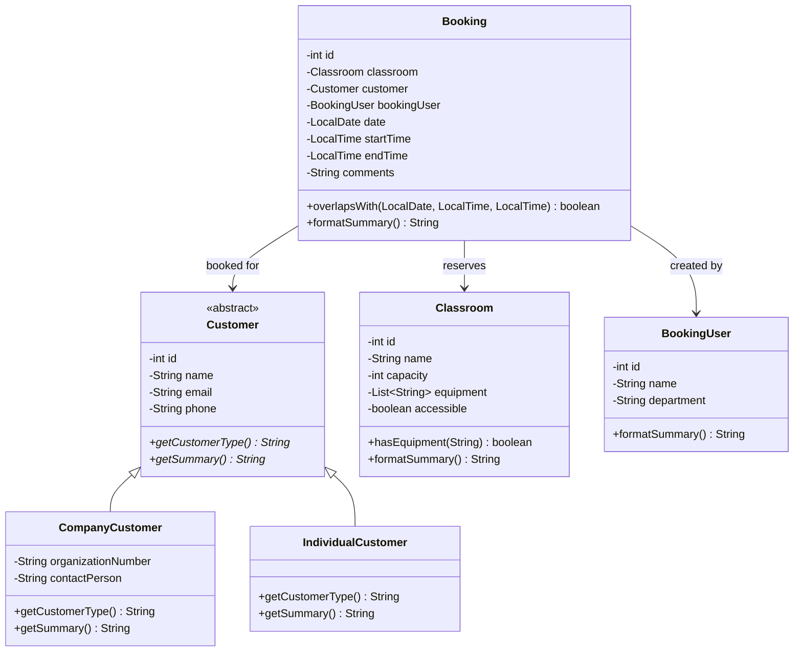
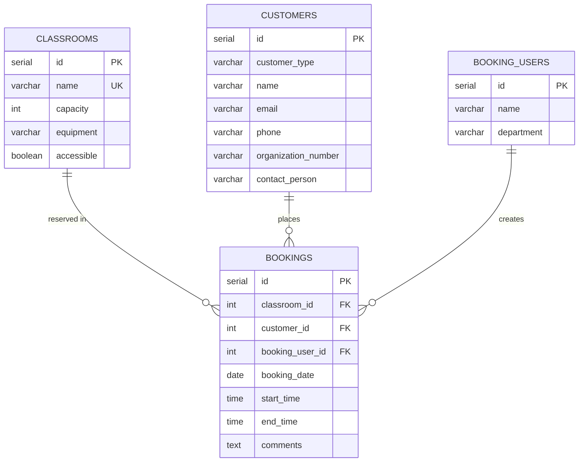

# 🏫 Classroom Rental App

A Java SE console application for managing training classroom rentals, customer registrations (companies and individuals), availability searches, and reservation scheduling with SQL + JDBC persistence.

## 📋 Overview

A facility management company owns **20 training classrooms** of varying capacities, equipment sets, and accessibility options. This system enables booking staff to:

* Register **Company** and **Individual** customers.

* View, add, and update the **20 training classrooms** (name, capacity, equipment, disability accessibility).

* Search available classrooms by **date, time range, minimum capacity, required equipment, and accessibility**.

* Create validated bookings linked to a **classroom**, **customer**, and **booking user**, with optional comments (e.g., allergies or setup notes).

* Prevent **double-bookings** for overlapping time ranges on the same date.

* View bookings filtered **by room**, **by customer**, or **all upcoming bookings**, as well as cancel reservations.

## 🏗️ Architecture & OOP Design

The project follows a layered architecture and core Object-Oriented Programming principles:

* **Encapsulation:** Private fields with validation in constructors and setters (`Classroom`, `Customer`, `Booking`, `BookingUser`).

* **Abstraction & Inheritance:** `Customer` is an abstract base class extended by `CompanyCustomer` and `IndividualCustomer`.

* **Polymorphism:** Customer types implement `getCustomerType()` and `getSummary()` polymorphically, while `RentalService` and `CustomerDao` operate on the `Customer` abstraction.

* **Collections, Streams & Lambdas:** Used in `RentalService` to filter available classrooms, detect booking time overlaps, and sort query results.

* **Exception Handling:** Custom domain exceptions (`ValidationException`, `DoubleBookingException`, `ResourceNotFoundException`, `DatabaseOperationException`) separate business rule violations from console I/O.

### UML Class Diagram



## 🗄️ Database Schema & ER Diagram

The PostgreSQL database (`classroom_rental`) uses four relational tables with primary/foreign keys and check constraints. Single-table inheritance is used in `customers` via `customer_type` (`COMPANY` or `INDIVIDUAL`).



## 📁 Project Structure

```text
classroom-rental-app/
├── pom.xml
├── sql/
│   └── schema.sql
├── src/
│   └── main/java/se/lexicon/classroomrental/
│       ├── Main.java
│       ├── config/
│       │   └── DatabaseConfig.java
│       ├── exception/
│       │   ├── DatabaseOperationException.java
│       │   ├── DoubleBookingException.java
│       │   ├── ResourceNotFoundException.java
│       │   └── ValidationException.java
│       ├── model/
│       │   ├── Booking.java
│       │   ├── BookingUser.java
│       │   ├── Classroom.java
│       │   ├── CompanyCustomer.java
│       │   ├── Customer.java
│       │   └── IndividualCustomer.java
│       ├── repository/
│       │   ├── BookingDao.java
│       │   ├── BookingUserDao.java
│       │   ├── ClassroomDao.java
│       │   └── CustomerDao.java
│       ├── service/
│       │   └── RentalService.java
│       └── ui/
│           └── ConsoleMenu.java
└── README.md
```

## ⚙️ Prerequisites & Setup

### 1. Prerequisites

* **Java 17+** (JDK)
* **Maven**
* **PostgreSQL**
* **Git**

### 2. Database Setup

1. Create a database named `classroom_rental`:

   ```sql
   CREATE DATABASE classroom_rental;
   ```

2. Run the schema and seed script to create all tables, seed the **20 classrooms**, and insert default booking users:

   ```bash
   psql -U postgres -d classroom_rental -f sql/schema.sql
   ```

### 3. Environment Variables

Configure your database credentials via environment variables (or rely on the local defaults in `DatabaseConfig`):

| Variable | Default Value | Description |
| :--- | :--- | :--- |
| `DB_URL` | `jdbc:postgresql://localhost:5432/classroom_rental` | JDBC connection URL |
| `DB_USER` | `postgres` | Database username |
| `DB_PASSWORD` | `postgres` | Database password |

### 4. Run the Application

Run `se.lexicon.classroomrental.Main` from your IDE or terminal:

```bash
mvn clean compile exec:java
```

## 🖥️ Console Menu Features

1. **Register Customer:** Add a Company (with organization number & contact person) or an Individual client.
2. **List All Customers:** View all registered customers sorted alphabetically.
3. **Manage Classrooms:** List all 20 classrooms, add new rooms, or update room details.
4. **Search Available Classrooms:** Filter rooms by date, start/end time, minimum capacity, equipment, and accessibility.
5. **Create New Booking:** Reserve an available room for a customer with optional notes (e.g., allergies).
6. **View Bookings by Room:** Display chronological reservations for a chosen room.
7. **View Bookings by Customer:** Display chronological reservations for a chosen customer.
8. **View All Upcoming Bookings:** View all future/active bookings across the facility.
9. **Cancel Booking:** Remove a reservation by booking ID.
